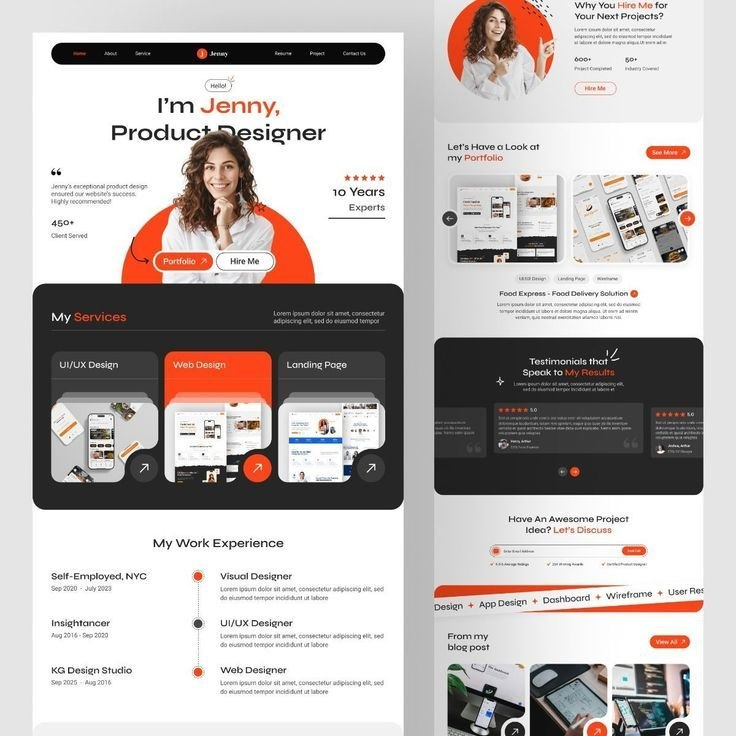

# DevKyng Portfolio — Design Reference

## Primary reference

This image is the primary visual reference for the entire portfolio.

Before changing the layout or styling, inspect this image and the existing website. Match its design language rather than replacing it with a generic portfolio template.

## Design direction

Reproduce the reference's:
- Typography scale, weight, hierarchy, and text alignment.
- Header proportions, navigation placement, and spacing.
- Hero composition, including portrait placement and decorative shapes.
- Use of whitespace and asymmetrical layouts.
- Contrast between white sections and large, dark rounded sections.
- Image-led project presentation.
- Section transitions, proportions, and overall visual rhythm.

The goal is to preserve the reference's recognizable composition while adapting its branding and content for DevKyng.

## Brand adaptation

- Brand: DevKyng
- Tagline: CODE. CREATE. SOLVE. SCALE.
- White: `#FFFFFF`
- Navy: `#0A1830`
- Blue: `#005DF6`
- Font stack: `-apple-system, BlinkMacSystemFont, "Segoe UI", Roboto, Helvetica, Arial, sans-serif`

Replace the reference's orange accents with brand blue. Use navy for dark sections and headings.

Do not copy the reference's original brand, text, or identity.

## Personal images

- Homepage portrait: `images/port2.jpg`
- About portrait: `images/port1.jpg`

Use the actual photographs. Do not generate replacement faces.

## Pages

- Home: distinctive reference-inspired hero and featured projects.
- About: concise professional introduction with minimal personal disclosure.
- Services: three services in a prominent navy section.
- Projects: three featured in-progress projects and two completed projects.
- Contact: clear invitation and working social links.

## Project imagery

Create consistent, original visuals for GrowStack, Passify, RentMate, Expense Tracker, and Basketball Scoreboard.

Use image-generation tools where available. Do not fabricate real product screenshots, implemented functionality, statistics, or achievements.

## Implementation rules

- Plain HTML, CSS, and JavaScript.
- No frameworks or build step.
- Shared `style.css`, `script.js`, header, and footer.
- Mobile-responsive layouts.
- System fonts only.
- No gradients, orange, generic centered hero templates, or uniform three-card feature grids.
- Missing images must not break the layout.
- Preserve working functionality and relative navigation links.

## Quality check

After implementation, compare the rendered homepage with the reference. Fix differences in typography, hero composition, portrait positioning, spacing, navigation proportions, and section layouts before applying the design across all pages.

# DevKyng Portfolio Design Reference

## Instructions
Treat the image above as the primary visual reference.
Reproduce its typography, layout, hero composition, spacing,
navigation, and section structure.

Adapt the design to DevKyng's branding:
- White background
- Navy: #0A1830
- Blue: #005DF6
- System fonts only

Use `images/port2.jpg` for the homepage portrait
and `images/port1.jpg` for the About page.